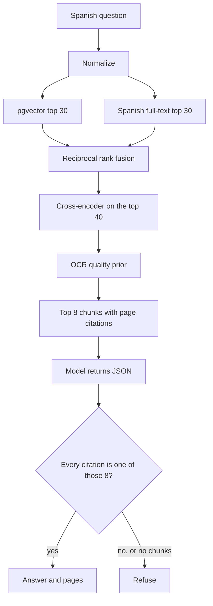

# Request path

This is the only diagram to draw. Draw it on paper before Session 2, and put this same picture at the top of the repo README in Session 8. A calendar diagram does not change the work.

## Modes

`--mode` defaults to `hybrid_rerank`, which is the path above and the behavior of `src/rag/retrieve_hybrid.py` today. Every mode returns `--k-final` chunks (default 8) and still formats page citations.

| Mode | Boxes it keeps | Models it loads |
| --- | --- | --- |
| `vector` | Normalize, pgvector, then cut to 8 | Embedder |
| `keyword` | Normalize, Spanish full-text, then cut to 8 | Neither |
| `hybrid` | Through reciprocal rank fusion, then cut to 8 | Embedder |
| `hybrid_rerank` | The full diagram | Embedder and cross-encoder |

`hybrid` skips the cross-encoder and the OCR prior. `vector` sorts by `vector_score`. `keyword` keeps the full-text order.

Fusion and the prior stay as they are in `docs/ranking_rules.md` of the repo until a saved report says a specific number should change. Do not retune 0.55 / 0.45 during the first experiments.

## Two checks on the vector box

Run these only in Session 4, and only as separate saved reports. Details of the order are in the how-to.

**Prefixes.** `intfloat/multilingual-e5-base` was trained with `passage: ` on indexed text and `query: ` on the question. The indexer embeds raw chunk text. Retrieval embeds the normalized question. Both sides match, so search runs, and the model is below the behavior it was trained for.

**IVFFlat probes.** The index is created with `lists = 100`. Postgres searches one list unless the session sets `ivfflat.probes`. On a small corpus that can drop the right chunk before the reranker sees it. Count chunks before interpreting a weak vector score. Probes are a session setting. They do not require a reindex. Prefixes do.

## Code map

| Step | File |
| --- | --- |
| Prepare corpus | `src/rag/run_mvp_prep.py` |
| Build index | `src/rag/build_retrieval_index.py` |
| Retrieve | `src/rag/retrieve_hybrid.py` |
| Answer | `src/rag/answer_with_rag.py` |
| Current smoke test | `src/rag/retrieval_smoke_test.py` |

Retrieval logic to split when adding `--mode`: `fetch_vector_hits`, `fetch_keyword_hits`, `hybrid_fuse`, `apply_quality_prior`, `format_citation`. `answer_with_rag.py` currently starts `retrieve_hybrid.py` in a subprocess. The eval imports `retrieve` and loads each model once. That is Session 3 in the how-to.
